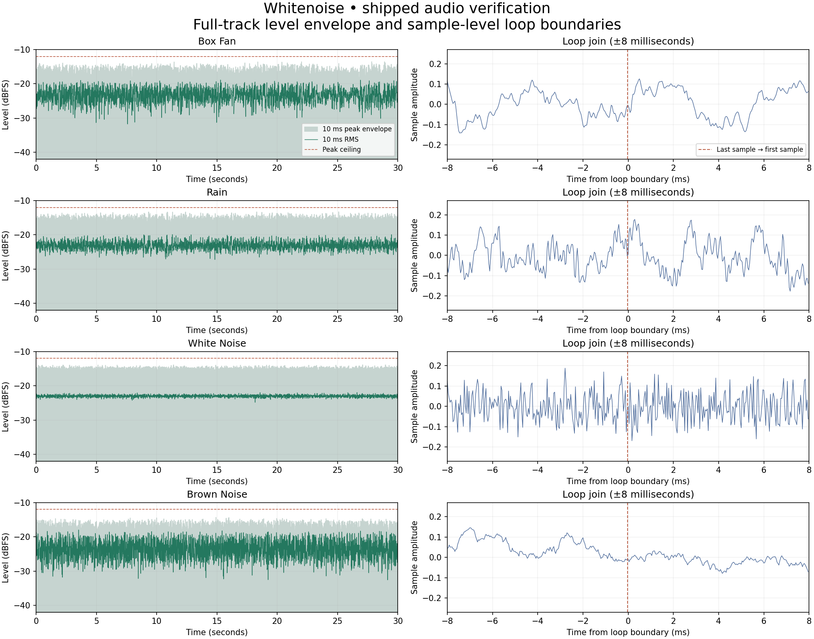

# Audio verification

The shipped files are four 30-second, 24 kHz, mono PCM16 WAV loops. The fan and
rain are adapted CC0 recordings; white and brown noise are generated originals
also dedicated under CC0. The preparation and verification scripts are MIT.
See [source credits](../../docs/audio/LICENSE.txt).

The recordings use a 3-second equal-power overlap of their outgoing and incoming
ends. This avoids a fade to silence. The actual file boundary joins originally
adjacent samples, then circular gain processing preserves continuity. Generated
noise is processed periodically. PCM avoids lossy encoder padding; gap-free
playback also requires the app's Web Audio buffer loop, rather than restarting
an HTML audio element or scheduling loop restarts with JavaScript timers.

Every track receives smooth level control, brief-transient reduction, and smooth
peak limiting. A common -23 dBFS RMS target avoids large average-level changes
when switching tracks. Normal stochastic noise still has varying samples and
short-term energy; these are not all identical-value samples or flat waveforms.

Run `node scripts/check-audio.mjs --report` to inspect the actual shipped PCM.
It checks circular sliding windows at 1 ms intervals, including the join:

- No clipped samples; peak amplitude at or below -12 dBFS.
- RMS within 0.02 dB of -23 dBFS and crest factor below 11 dB.
- No 10 ms window below -40 dBFS (no silence gaps).
- No 10 ms window above -17.5 dBFS or 50 ms window above -20 dBFS.
- Every 1-second window between -24 and -22.5 dBFS.
- No 10 ms burst more than 6 dB above its local 250 ms energy.
- Negligible DC offset and loop sample step below the track's ordinary 99th
  percentile sample step.

All four tracks pass. Observed global peaks range from -14.26 to -13.25 dBFS.
All sliding 1-second windows range from -23.52 to -22.56 dBFS. These checks bound
short bursts and longer loudness changes across the entire track; they do not
constitute a listening test or a guarantee of a device's background playback.

[Detailed measurements](measurements.json) · [Source checksums](source-checksums.json)



Rebuild audio with Python 3, NumPy, and ffmpeg:

```sh
python3 scripts/prepare-audio.py --source-dir /tmp/whitenoise-audio-source
node scripts/check-audio.mjs --report
python3 scripts/plot-audio.py
```

The plotting step additionally requires Matplotlib. Source downloads are checked
against pinned SHA-256 hashes. Audio output may vary slightly with ffmpeg/NumPy
versions; rerun the shipped-file checks after regeneration.
